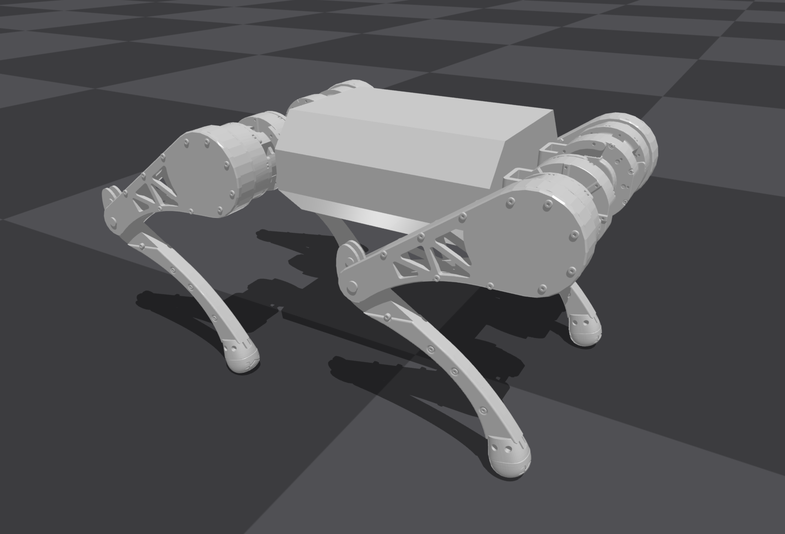

# WDBLH 犀牛派x1框架文档
本项目基于（Isaac Gym / HIMloco ） 训练
本仓库提供 WDBLH 四足机器人的强化学习实机部署框架。<br> **策略模型已通过 [AIMO](https://aimo.aidlux.com/#/model-convert) 进行加速。** 

## 功能与范围

- 通过串口接入 IMU（惯性测量单元）和 STM32 电机控制板。
- 使用 FSM（有限状态机）管理待机、起立、策略控制和趴下。
- 检查电机反馈，并在满足条件后授予运动权限。
- 提供 HTTPS 网页手柄、本机控制守护进程和 UDP（用户数据报协议）导航接口。
- 通过 AidLite 调用 QNN248 的 DSP（数字信号处理器）后端，运行当前 AIDEM 模型。

当前工程仅支持 WDBLH。其他机器人、ROS、Gazebo、MuJoCo、Docker、
LibTorch 和 CUDA 构建路线已移除。
工程保留可选 ONNX 后端代码，尚未提供与当前配置匹配的 ONNX 模型。

## 项目结构

<details>
<summary>📁 src — 主控代码（点击展开）</summary>

- [📁 rl_sar](src/rl_sar/)
- [📄 主控程序](src/rl_sar/src/rl_real_wdblh.cpp)
- [📄 状态机](src/rl_sar/fsm_robot/fsm_wdblh.hpp)

</details>

<details>
<summary>📁 policy — 策略与配置</summary>

- [📄 基础配置](policy/wdblh/base.yaml)
- [📄 策略配置](policy/wdblh/himloco/config.yaml)
- [📄 模型说明](policy/wdblh/himloco/model-card.md)

</details>

<details>
<summary>📁 scripts — 启动和安装脚本</summary>

- [📄 启动主控](scripts/run_wdblh.sh)
- [📄 离线检查](scripts/check_offline.sh)

</details>

主要目录与关键文件如下：

```text
wdblh/
├── CMakeLists.txt                                   # 工程根构建入口
├── src/rl_sar/                                      # 主控与公共控制代码
│   ├── CMakeLists.txt                               # WDBLH 构建目标与推理后端选项
│   ├── src/rl_real_wdblh.cpp                        # 实机主控：串口、控制循环和 UDP 输入
│   ├── fsm_robot/fsm_wdblh.hpp                      # 待机、起立、策略控制和趴下状态机
│   ├── include/                                     # 主控接口与反馈保护
│   │   ├── rl_real_wdblh.hpp                        # 主控类声明
│   │   └── wdblh_motor_gate.hpp                     # 电机反馈检查与运动授权
│   └── library/core/                                # 必要公共依赖
│       ├── rl_sdk/                                  # 观测构建、动作处理和控制参数
│       ├── inference_runtime/                       # 统一推理接口与 AidLite、可选 ONNX 后端
│       ├── observation_buffer/                      # 历史观测缓存
│       ├── fsm/                                     # 通用状态机
│       ├── loop/                                    # 循环线程
│       ├── logger/                                  # 日志工具
│       └── vector_math/                             # 向量与四元数运算
├── resources/robots/wdblh_v5/                       # WDBLH 机器人描述与几何资源
│   ├── urdf/wdblh_v5.urdf                           # 连杆、关节、限位和惯性参数
│   ├── meshes/                                      # URDF 引用的 17 个 STL 网格
│   ├── README.md                                    # 资源来源与使用说明
│   ├── source-manifest.json                         # 导入文件的来源和校验值
│   └── SOURCE_LICENSE                               # 来源工程许可证原文
├── standalone/                                      # 原生驱动、协议和诊断源码
│   ├── dm_imu_raw.cpp                               # IMU 串口驱动实现，接口见同名 .h 文件
│   ├── pc_protocol.cpp                              # STM32 电机协议实现，接口见同名 .h 文件
│   ├── test_inference_runtime.cpp                   # 纯推理检查，不打开串口
│   ├── test_imu_raw.cpp                             # IMU 读取诊断，运行时访问硬件
│   ├── test_motor_raw.cpp                           # 电机通信诊断，运行时可能发送命令
│   └── test_policy_qnn.py                           # AidLite Python 推理检查
├── policy/wdblh/                                    # 机器人标定与策略配置
│   ├── base.yaml                                    # 基础控制参数、关节映射和方向
│   └── himloco/                                     # 当前策略
│       ├── config.yaml                              # 观测、PD 增益和动作缩放
│       ├── himloco1_fix_qcs8550_fp16.qnn248.ctx.bin.aidem
│       └── model-card.md                            # 模型接口、来源和使用条件
├── gamepad_bridge/                                  # 网页手柄与本机控制服务
│   ├── run.sh                                       # 网页服务启动入口
│   ├── server.py                                    # HTTPS、WebSocket 和手柄 UDP 转发
│   ├── wdblh_control_daemon.py                      # 主控启停与阻尼控制
│   ├── static/                                      # 手柄页、监视页和网页资源
│   └── requirements.txt                             # 网页服务 Python 依赖
├── scripts/                                         # 启动、安装和离线检查
│   ├── wdblh_env.sh                                 # 统一读取本机环境配置
│   ├── wdblh_boot.sh                                # 统一启动网页、守护进程和主控
│   ├── run_wdblh.sh                                 # 解析串口并启动主控
│   ├── wdblh.service                                # systemd 服务模板
│   ├── install_wdblh_udev.sh                        # 安装固定串口别名
│   ├── install_wdblh_autostart.sh                   # 安装并配置开机自启动
│   ├── check_offline.sh                             # 构建并运行无设备检查
│   └── check_default_dof_pos.py                     # 辅助核对关节默认角
├── config/wdblh.env.example                         # 本机路径、用户、串口和网络参数模板
├── tests/                                           # 配置、迁移和协议一致性检查
├── LICENSE                                          # Apache-2.0 许可证
└── third-party-notices.md                           # 上游归属、第三方依赖和模型许可说明
```

## 环境要求

工程运行于 Linux。以下按构建、Python 工具和实机推理列出依赖。
基础依赖和 Python 检查依赖即可用于离线验证。

### 基础构建

| 依赖 | 要求与用途 |
| --- | --- |
| C++ 编译器 | 支持 C++17；离线验证使用 GCC 11.4.0 |
| CMake | 3.16 或更高版本 |
| Make 或 Ninja | 执行 CMake 生成的构建任务 |
| yaml-cpp | 读取控制与策略 YAML；已验证 0.7 和 0.9 |
| TBB | 公共控制代码的并行计算依赖；离线验证使用 oneTBB 2021.5 |
| POSIX 线程库 | 由 Linux 工具链提供，CMake 通过 `Threads` 查找 |

### Python 工具

Python 需要 3.10 或更高版本，并准备 pip 和虚拟环境工具。
依赖范围来自工程中的 `requirements.txt`，按用途安装。

| 依赖 | 版本范围 | 用途 |
| --- | --- | --- |
| aiohttp | `>=3.9,<4` | 网页 HTTP 和 WebSocket 服务 |
| cryptography | `>=42,<47` | 生成 HTTPS 证书与密钥 |
| qrcode[pil] | `>=7.4,<9` | 生成网页入口二维码，并安装 Pillow 图像依赖 |
| PyYAML | `>=6,<7` | 离线配置检查和默认关节角核对 |

网页依赖见 [gamepad_bridge/requirements.txt](gamepad_bridge/requirements.txt)。
[tests/requirements.txt](tests/requirements.txt) 同时包含网页依赖和 PyYAML，供完整离线检查使用。

### 实机推理与启动

| 依赖 | 使用条件 |
| --- | --- |
| AidLite C++ SDK | AIDEM 模型必需；启用 `ENABLE_AIDLITE=ON` 时需要头文件和库 |
| QNN248 DSP 插件 | 当前模型必需，应与目标设备和 AidLite 环境匹配 |
| 设备授权 | 按供应商要求为目标设备准备 |
| Bash 与系统工具 | 启动脚本使用 Bash、`flock`、`runuser` 和 `pgrep`；指定网卡探测时使用 `ip` |
| systemd 与 udev | 安装服务和固定串口别名时使用 |

ONNX Runtime 仅在启用 `ENABLE_ONNX=ON` 时需要，当前 QNN 路线不使用它。
`standalone/test_policy_qnn.py` 另需供应商 Python `aidlite` 和 NumPy。
这些可选依赖不属于默认离线检查的安装范围。


## 部署

以下命令在目标主控板的工程根目录执行。
先准备匹配的 AidLite SDK、QNN248 DSP 插件和设备授权。

### 安装依赖

Ubuntu 用户可安装基础构建和 Python 工具：

```bash
sudo apt install build-essential cmake libyaml-cpp-dev libtbb-dev python3-pip python3-venv
```

由运行网页服务的非 root 账户准备网页依赖：

```bash
python3 -m pip install --target gamepad_bridge/.deps \
  -r gamepad_bridge/requirements.txt
```

### 编译主控

启用 AidLite 后端，生成主控和纯推理检查程序：

```bash
cmake -S src/rl_sar -B cmake_build_cpu \
  -DUSE_CMAKE=ON -DENABLE_LIBTORCH=OFF -DENABLE_AIDLITE=ON
cmake --build cmake_build_cpu --target rl_real_wdblh test_inference_runtime -j2
```

主控输出为 `cmake_build_cpu/bin/rl_real_wdblh`。
SDK 位于自定义目录时，在 CMake 配置命令中添加 `-DAIDLITE_ROOT=/path/to/sdk`。
将示例路径替换为实际 SDK 路径。

### 配置设备

首次部署时复制配置模板；已有本机配置时直接编辑原文件：

```bash
cp config/wdblh.env.example config/wdblh.env
```

在 `config/wdblh.env` 中填写网页账户和串口，例如：

```bash
WDBLH_BRIDGE_USER=YOUR_ACCOUNT
WDBLH_IMU_PORT=/dev/wdblh_imu
WDBLH_MOTOR_PORT=/dev/wdblh_motor
WDBLH_IMU_BAUD=921600
WDBLH_MOTOR_BAUD=4000000
```

将 `YOUR_ACCOUNT` 替换为已有的非 root 网页账户。
该账户需要能够写入网页依赖目录和证书目录。
串口填写实际设备路径；示例中的固定别名需要先安装 udev 规则：

```bash
bash scripts/install_wdblh_udev.sh --dry-run
sudo bash scripts/install_wdblh_udev.sh
```

未设置显式串口时，启动脚本会自动探测。
同时核对 CPU 绑定编号、动态库路径和两份 YAML 中的关节标定。
本机参数见[配置模板](config/wdblh.env.example)。

### 检查模型推理

加载本机环境配置，再执行不访问串口的推理检查：

```bash
source scripts/wdblh_env.sh
./cmake_build_cpu/bin/test_inference_runtime \
  policy/wdblh/himloco/himloco1_fix_qcs8550_fp16.qnn248.ctx.bin.aidem 276 200
```

成功时应输出 `PASS backend=qnn248` 和重新加载检查结果。
当前模型输入为 276 维，输出为 12 维。
旧 270 维 ONNX 模型不能直接替换，详见[模型说明](policy/wdblh/himloco/model-card.md)。

### 手动启动实机

完成推理检查和标定核对后，执行统一启动脚本：

```bash
sudo bash scripts/wdblh_boot.sh
```

该脚本启动本机控制守护进程、HTTPS 网页手柄和实机主控。
主控通过 `scripts/run_wdblh.sh` 解析串口，并使用四参数接口启动：

```text
rl_real_wdblh /dev/wdblh_imu /dev/wdblh_motor 921600 4000000
```

默认网页地址为 `https://主控地址:8443/`，监视页路径为 `/monitor`。
首次使用时按浏览器要求信任本机 CA 证书。
反馈连续有效达到 300 ms 后，松开再按下 A 起立；起立完成后按 Y 进入策略控制。

默认启动日志可在另一终端查看：

```bash
tail -n 30 -F logs/boot.log
```

主控日志位于 `logs/controller.log`，网页日志位于 `logs/bridge.log`。
网页“故障急停”通过守护进程停止主控并持续发送阻尼命令，依赖软件与通信链路。

### 配置开机自启动

完成手动实机验证后，先预览服务文件，再安装：

```bash
bash scripts/install_wdblh_autostart.sh --dry-run --user YOUR_ACCOUNT
sudo bash scripts/install_wdblh_autostart.sh --user YOUR_ACCOUNT
```

`YOUR_ACCOUNT` 应与本机配置中的网页账户一致。
安装器启用下次开机自启动，不立即启动或重启主控。
`scripts/wdblh.service` 是模板，由安装器生成实际服务文件。

通过 systemd 运行时，可查看和停止服务：

```bash
systemctl status wdblh.service
journalctl -u wdblh.service
sudo systemctl stop wdblh.service
```


## 致谢

本工程基于 [fan-ziqi/rl_sar](https://github.com/fan-ziqi/rl_sar) 。<br>
感谢原作者 Ziqi Fan 和上游贡献者提供的强化学习部署框架。<br>
必要公共代码和上游版权声明予以保留。<br>
上游贡献者名单见 [CONTRIBUTORS.md](CONTRIBUTORS.md)。<br>
